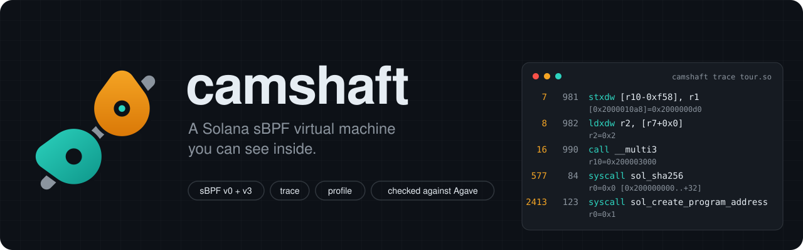
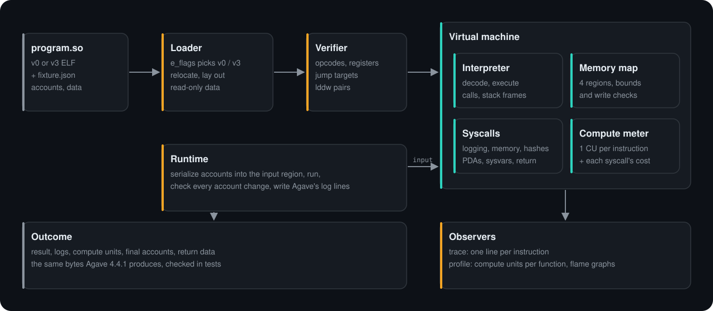

<p align="center">
  
</p>

<p align="center">
  <a href="LICENSE"></a>
  
  
  
</p>

camshaft runs Solana programs and shows you everything they do: every instruction, every
register it changes, every byte it writes, every compute unit it spends. It is a complete
sBPF virtual machine and program runtime, written from scratch in Rust, and it gives the
same result, logs, compute units and accounts as Agave, the validator most of mainnet runs.

## Why camshaft

- **See inside.** `camshaft trace` prints one line per instruction. `camshaft profile` tells
  you which function spends your compute units, and writes flame graphs.
- **Small.** 68 crates in total, against 292 for `mollusk-svm`. A clean release build takes
  about 7 seconds and the binary is 1.4 MB. No validator, no JIT, no `unsafe`.
- **Readable.** About 5,000 lines of Rust, and [ten short guides](#guides) that explain
  each part in plain words. Read it to learn how Solana actually runs a program.
- **Checked, not trusted.** Every instruction is compared against Anza's VM, and every log
  line against Agave 4.4.1. Details in [How it's checked](#how-its-checked).

It is not fast. Anza's VM compiles programs to native code; camshaft interprets them, one
instruction at a time, so it can show you each one. Use it to understand and measure
programs, not to run a validator.

## Quick look

Which part of a program costs the most:

```
$ camshaft profile tour.so --input tour.json
  self CU  total CU   calls  function
     3001      3001       1  sol_try_find_program_address
     1501      1501       1  sol_create_program_address
      505       505       5  sol_log_64_
      303       303       3  sol_log_pubkey
      278      7380       1  entrypoint
      169       451       1  solana_program_entrypoint::deserialize
      ...
```

What each instruction did:

```
$ camshaft trace tour.so --input tour.json
     CU     pc  instruction                       changes
      5      9  call solana_program_entrypoint::deserialize r10=0x200002000
      7    981  stxdw [r10-0xf58], r1             [0x2000010a8]=0x2000000d0
      8    982  ldxdw r2, [r7+0x0]                r2=0x2
    ...
    577     84  syscall sol_sha256                r0=0x0 [0x200000000..+32]
```

## Install

```
cargo install camshaft
```

Or from source: `cargo install --git https://github.com/simplysabir/camshaft`. Needs Rust
1.95 or newer.

## Usage

```
camshaft run     program.so --input fixture.json   # run one instruction
camshaft trace   program.so --input fixture.json   # one line per instruction
camshaft profile program.so --input fixture.json   # compute units per function
camshaft profile program.so --input fixture.json --folded out.folded   # for flame graphs
camshaft disasm  program.bin [--v3]                # raw bytecode as assembly
```

`program.so` is what `cargo build-sbf` builds (add `--arch v3` for v3), or a program dumped
from mainnet with `solana program dump <PROGRAM_ID> program.so`. For function names in a
profile, use the unstripped copy in `target/<target>/release/`.

The fixture says which accounts the instruction gets and what data it carries:

```json
{
  "program_id": "29d2S7vB453rNYFdR5Ycwt7y9haRT5fwVwL9zTmBhfV2",
  "instruction_data": "0500000000000000",
  "accounts": [
    {
      "pubkey": "2DYKaRPBeNM5WdW8rNsYEktjPrnd89Mm4Lzp3qonSzoj",
      "is_writable": true,
      "owner": "29d2S7vB453rNYFdR5Ycwt7y9haRT5fwVwL9zTmBhfV2",
      "lamports": 1000000,
      "data": "0200000000000000"
    }
  ]
}
```

Every field and its default is in [guide 06](docs/06-input-and-compute.md). Without
`--input`, the program runs with no accounts and no data.

## As a library

```rust
use camshaft::executable::Executable;
use camshaft::fixture;
use camshaft::runtime::process_instruction;

let exe = Executable::from_elf(&std::fs::read("counter.so")?)?;
exe.verify()?;
let input = fixture::parse(&std::fs::read_to_string("counter.json")?)?;
let outcome = process_instruction(&exe, &input.instruction, &input.accounts, &input.env);
println!("{:?} in {} compute units", outcome.result, outcome.compute_units);
```

`process_instruction_observed` takes an `Observer` that sees every instruction, which is
how `trace` and `profile` are built.

## How it works

<p align="center">
  
</p>

The loader reads the ELF, the verifier rejects anything unsafe to run, and the runtime lays
the accounts out in memory the way Agave does. Then the VM runs the program one instruction
at a time, charging compute units, and the runtime checks every account change on the way
out. Observers like `trace` and `profile` see each step without changing it.

## How it's checked

camshaft was written from scratch, then compared against the real thing until they agreed.

| what runs | compared with | what must match |
|---|---|---|
| every opcode byte, with many field values | Anza's VM (`solana-sbpf`) | verifier verdict, disassembly |
| hand-written programs, Anza's 186 test programs and 28 test ELFs, as v0 and v3 | Anza's VM | result or error, registers, pc, instruction count, all memory |
| random programs, about 10,000 a second | Anza's VM | the same |
| real programs: a counter, a tour of every syscall and 12 ways to fail, SPL Memo from mainnet, as v0 and v3 | Agave 4.4.1 with mainnet's feature flags | result, every log line, compute units, final accounts, return data |

## What it runs

- sBPF v0 and v3: the format `cargo build-sbf` makes by default, and the new one. v1 and v2
  never reached mainnet, and v4 is not out yet.
- 19 syscalls: logging, `abort` and panics, the memory functions, the heap allocator,
  sha256 and keccak256, program addresses, the clock and rent sysvars, and return data.
- Agave's input layout, account rules, compute costs and log lines.

Not yet: cross-program invocation, and the remaining syscalls (other hashes and curves,
`sol_get_sysvar` and friends). A program that calls one fails; for v0 programs,
`camshaft run` names the syscall it is missing.

## Guides

Short, plain notes on each part, in the order a program meets them:

- [00: Instructions](docs/00-instructions.md): how bytecode is laid out
- [01: Interpreter](docs/01-interpreter.md): the run loop and the math rules
- [02: Memory](docs/02-memory.md): the address map and access checks
- [03: Verifier](docs/03-verifier.md): what is rejected before a program runs
- [04: ELF loading and function calls](docs/04-elf-and-calls.md)
- [05: Syscalls](docs/05-syscalls.md)
- [06: Program input and compute units](docs/06-input-and-compute.md)
- [07: Differential testing](docs/07-differential-testing.md): how camshaft is checked
- [08: sBPF v3](docs/08-sbpf-v3.md): what changed and why
- [09: Tracing and profiling](docs/09-trace-and-profile.md)

## License

GPL-2.0-or-later. See [LICENSE](LICENSE).

The test ELFs and assembly programs under `tests/` come from
[anza-xyz/sbpf](https://github.com/anza-xyz/sbpf), used under its MIT license.
